# omarchy-ambient

Live backgrounds and screensavers for [Omarchy](https://omarchy.org): programs
that draw behind your windows instead of a still image or a video, or over
everything once you step away.

It sits next to OWE, Omarchy's wallpaper engine, rather than replacing it:
OWE plays images and videos, omarchy-ambient runs programs. While a live
background is up, OWE is paused, and it resumes when the program ends.

It comes with three:

- **Omarchy Effects**: the Omarchy screensaver's ttfx effects drawn on the GPU
  by `omarchy-ttfx-layer`, which keeps its frame rate within what the
  computer can afford. It comes with the Omarchy Audio Background plugin, or
  set `binary=` in `~/.config/omarchy/ambient/ttfx.conf`.
- **Amiga Demos**: classic demoscene productions running in FS-UAE. The demos
  are downloaded the first time you choose them. As a screensaver it goes
  through all of them, muted.
- **Terminal Effects**: the same effects in a kitty or ghostty terminal, for
  computers without the GPU renderer.

All three run as the background; Omarchy Effects and Amiga Demos also run as
the screensaver.

Anyone can add more: a terminal program, an emulator, a shader, a game. See
[Creating a live background](docs/creating-sources.md).

## Try the ASCII scenes

```sh
curl -fsSL https://raw.githubusercontent.com/avillagran/omarchy-ambient/main/install.sh | bash
```

It installs for your user under `~/.local`, without sudo, and verifies the download.
Remove it with the same command, ending in `| bash -s -- --uninstall`.

```sh
omarchy-ambient start sand-clock-galaxy            # try one
omarchy-ambient-select background                  # pick the background, with live previews
omarchy-ambient-select screensaver                 # pick the screensaver, the same way
omarchy-ambient stop                               # back to your wallpaper
```

In the carousel, arrows left and right choose a scene and up and down change its
resolution, live behind the carousel. Plus and minus set its frame rate limit, by
10 or by 20 with Shift, and F shows the fps. Enter keeps it, Escape restores it.
Scenes start at 20 fps and return to it on battery.

One engine runs them all: every scene works as a background and as a screensaver.
Every scene is drawn from text glyphs on the GPU, reacts to what is playing, and
follows the cursor.

| | | |
|---|---|---|
| 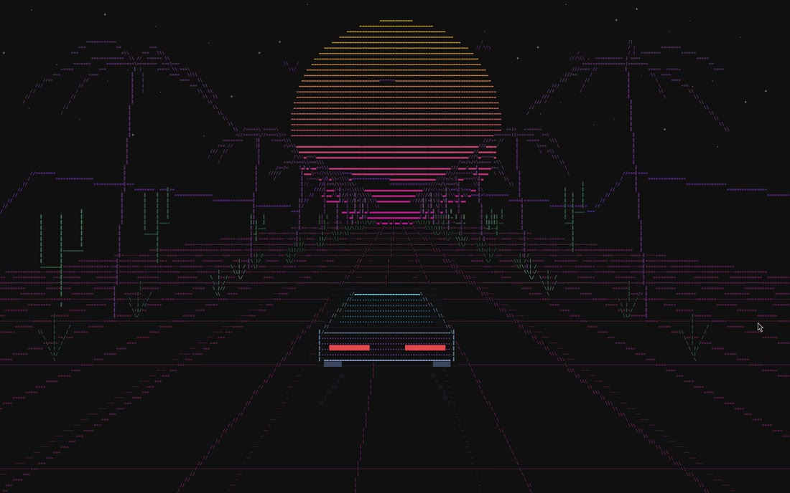 | 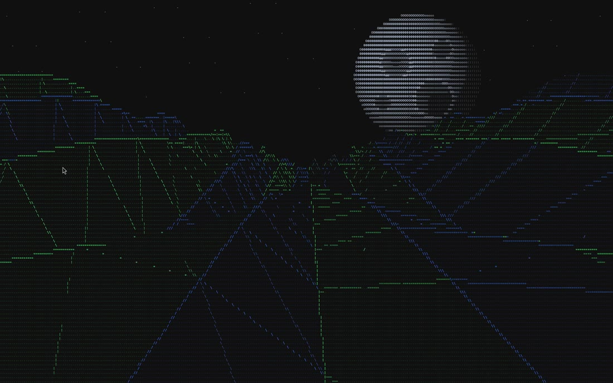 | 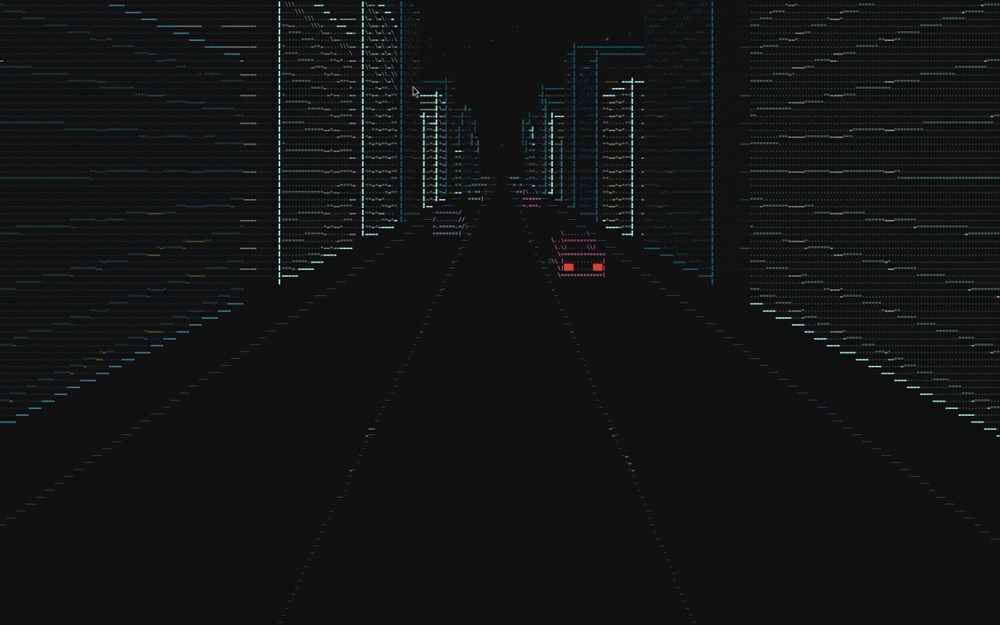 |
| Sunset Drive | Lunar Drift | Neon City |
| 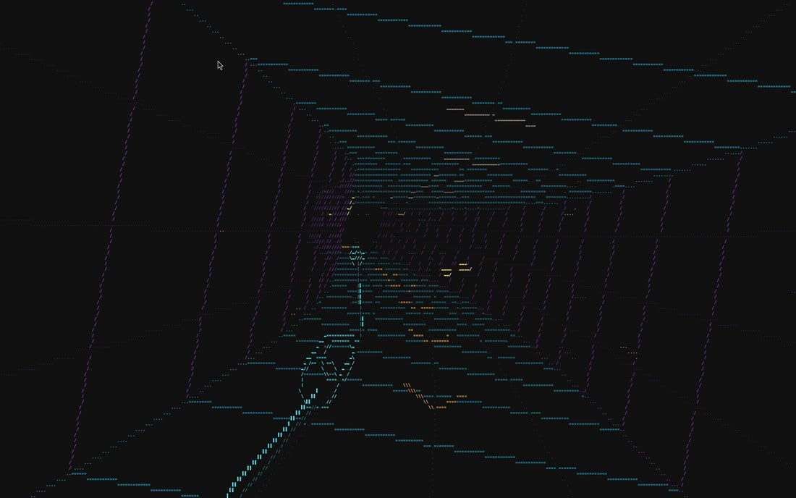 | 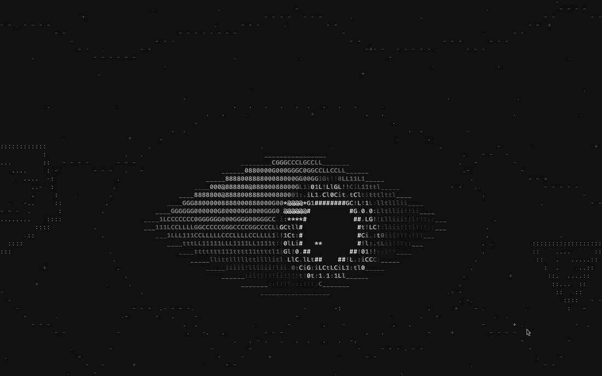 | 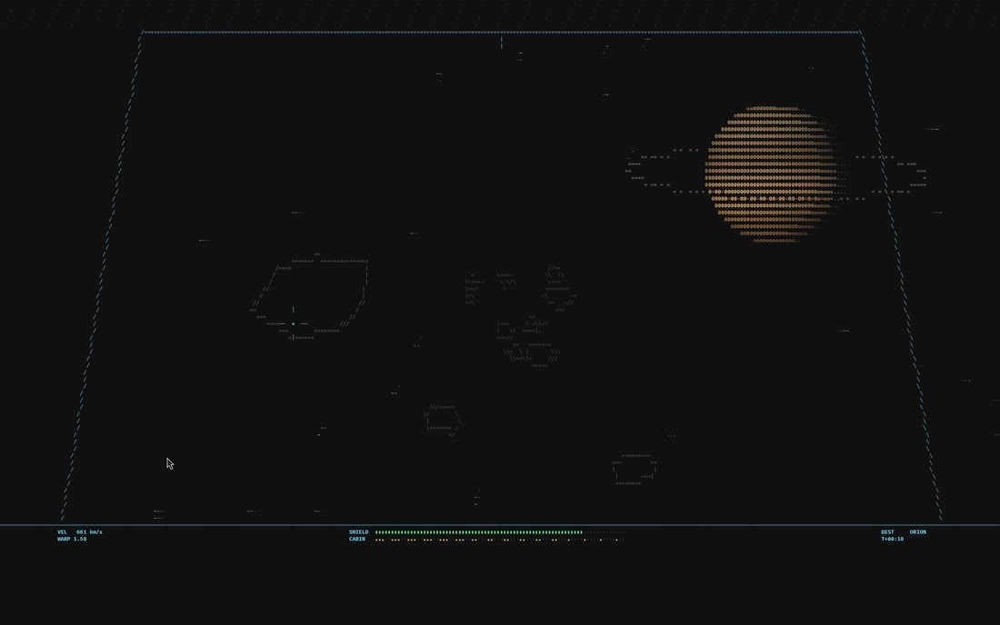 |
| Neon Transit | Eye | Cockpit |
| 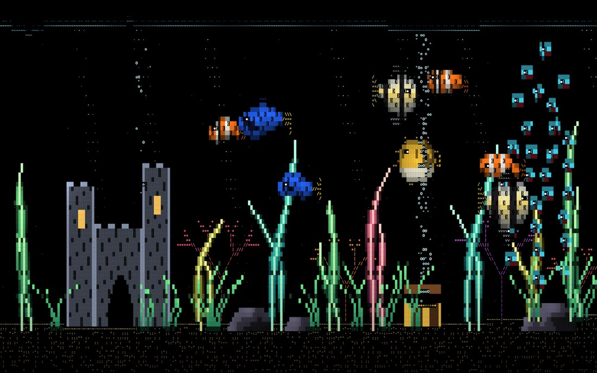 | 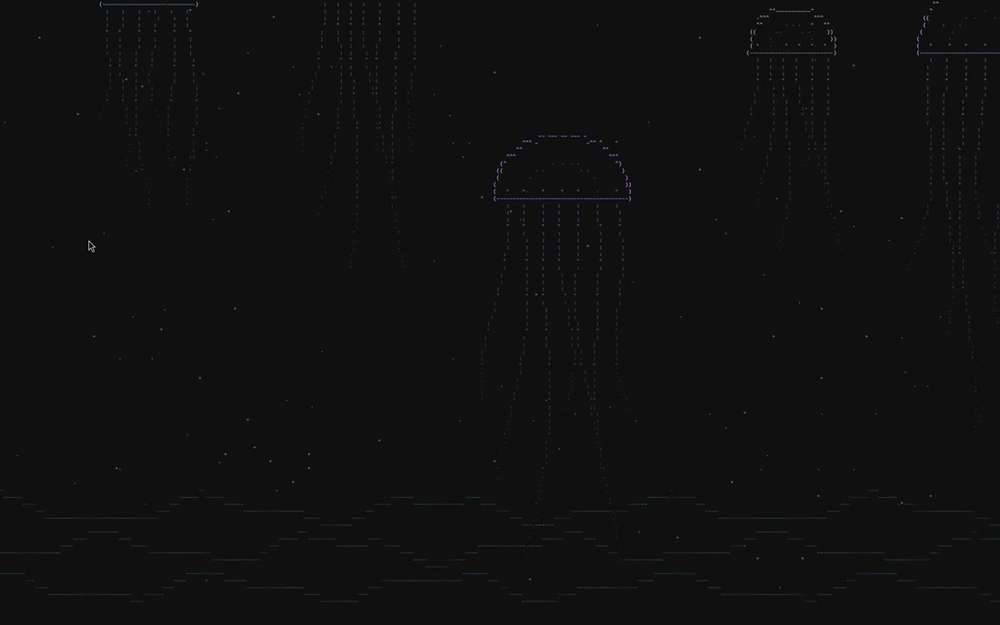 | 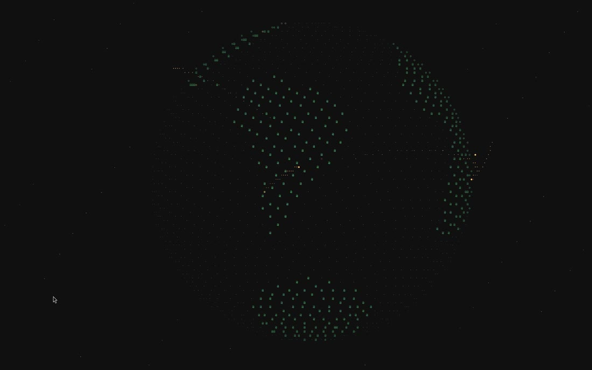 |
| Aquarium | Jellyfish | Data Globe |
| 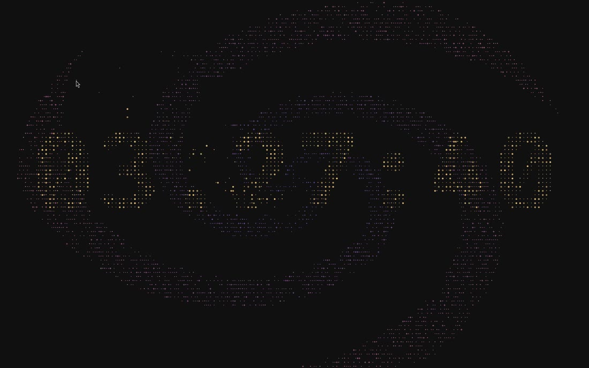 | 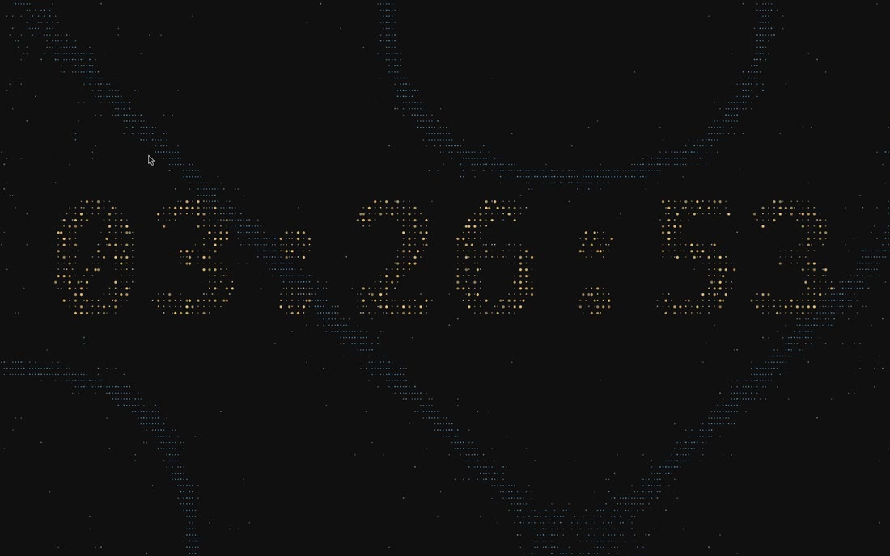 | 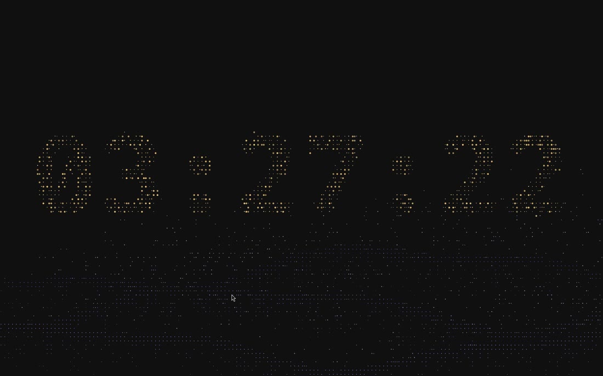 |
| Sand Clock Galaxy | Sand Clock Chladni | Sand Clock Dunes |

## How it works

Each live background is a program that draws its own layer surface on the
bottom layer, behind the windows and above the regular wallpaper. Nothing is
converted to video. A supervisor runs it as the `omarchy-ambient` user unit
and:

- starts one program per monitor (or one in total), and follows monitors
  being plugged in and out;
- pauses OWE while a live background runs, and resumes it afterwards;
- freezes a monitor's program with SIGSTOP while the monitor is off or shows
  a fullscreen window, while the session is locked, and on battery, so a
  background nobody sees costs nothing;
- restarts a program that dies, and gives up on one that keeps dying;
- ends when you set an ordinary background or a theme.

## Usage

```sh
omarchy-ambient list                    # the sources, as menu rows
omarchy-ambient start screensaver       # start one, in the background
omarchy-ambient start amiga             # pick a demo first
omarchy-ambient status                  # what is running, or "none"
omarchy-ambient stop
```

### In Omarchy's menus

Omarchy releases that know about omarchy-ambient list the sources under
**Appearance › Live Background** and **Appearance › Branding › Screensaver**
by themselves. On the others, one command adds the same rows to your menu
extension and routes the idle screensaver through omarchy-ambient:

```sh
omarchy-ambient install     # menu rows, and the idle service routed
omarchy-ambient installed   # menu=yes|no|native idle=yes|no|native
omarchy-ambient remove      # Omarchy's own menu and idle service back
```

The rows go between two marked lines in
`~/.config/omarchy/extensions/omarchy-menu.jsonc`, and nothing else in that
file changes. The idle service is cloned into
`~/.config/omarchy/plugins/omarchy-ambient.idle`, because Omarchy's idle
service runs its own screensaver launcher by a path no user file can
override. Run `install` again after adding a source, so it gets a row.

### As the screensaver

```sh
omarchy-ambient screensaver --set amiga   # use it at the idle timeout
omarchy-ambient screensaver               # run it now; any activity ends it
omarchy-ambient screensaver --get         # the selected one, or "text"
omarchy-ambient screensaver --set text    # back to Omarchy's own
```

A screensaver covers every monitor with the keyboard to itself and the cursor
hidden, ends on the first mouse motion, click, scroll or key, and gives way to
the lock screen. Omarchy's launcher has to hand over to it; see
[docs/omarchy](docs/omarchy/README.md). The design is in
[docs/screensaver-mode.md](docs/screensaver-mode.md).

## Install

Building needs a C compiler, `wayland-scanner` and `wayland-protocols`:

```sh
make
make install PREFIX=~/.local
omarchy-ambient install
```

At run time it needs `bash`, `jq`, `socat`, `inotifywait` (inotify-tools) and
Hyprland, and the Omarchy Effects source needs
[omarchy-ttfx-layer](https://github.com/avillagran/omarchy-ttfx-layer) on the
PATH. Each other source lists what else it needs, and offers to install it the
first time it starts. `packaging/arch/PKGBUILD` builds the package for x86_64
and aarch64.

### Coming from omarchy-bg-live

This was called omarchy-bg-live at first. `make install` removes the old
program, the first run moves `~/.config/omarchy/bg-live` and
`~/.local/share/omarchy-bg-live` over, and `omarchy-ambient install` swaps the
old menu rows and idle clone for the new ones. `omarchy-ambient omarchy
install|uninstall|status` still work.

## Tests

```sh
make test
```

`test/hardware` checks it all on a real Hyprland session, with nobody at the
keyboard (a virtual pointer and `wtype` stand in for the user). They draw on
the screen, so run them where nobody is working:

```sh
make -C test/hardware
test/hardware/screensaver-check.sh amiga 20   # every input ends it, nothing reaches the window under it, 20 cycles
test/hardware/background-check.sh amiga       # bottom layer, frozen under fullscreen and the screensaver
test/hardware/trial-idle.sh install .         # route the real idle cycle through a checkout (undo with undo)
```

## License

MIT. `vendor/gtk4-layer-shell` is gtk4-layer-shell 1.3.0 by Sophie Winter,
also MIT; see its LICENSE.
